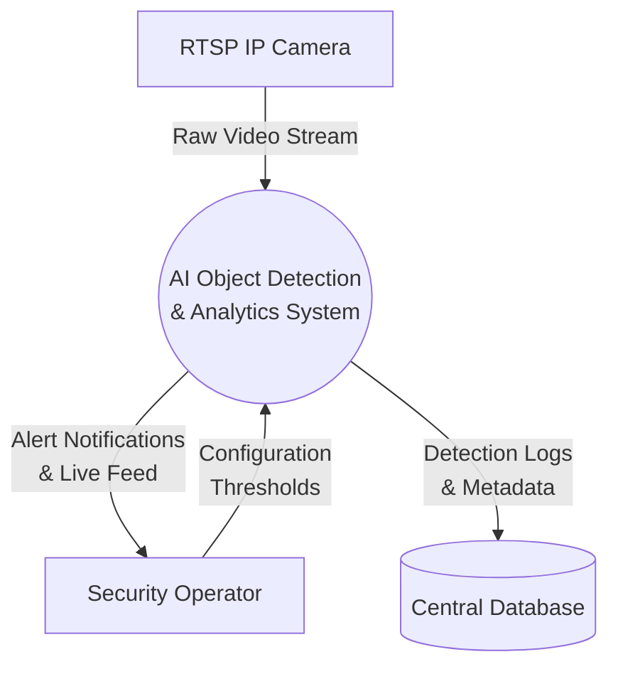
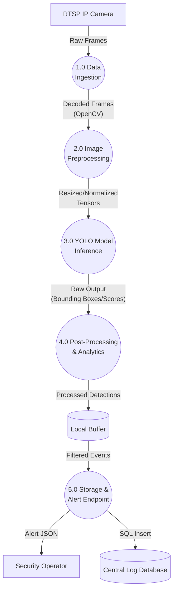

### 1. System Requirements

| Requirement ID | Type | Description |
| --- | --- | --- |
| **FR-01** | Functional | The system shall capture real-time video feeds from network cameras using RTSP protocols. |
| **FR-02** | Functional | The system shall detect faces in incoming frames and extract bounding box coordinates for alignment. |
| **FR-03** | Functional | The system shall identify individuals by matching facial embeddings against a registered database. |
| **FR-04** | Functional | The system shall log the recognized individual's ID, timestamp, and model confidence score. |
| **FR-05** | Functional | The system shall synchronize local attendance records with a central database at scheduled intervals. |
| **NFR-01** | Non-Functional | Face detection and inference latency must remain under 50ms per frame to ensure real-time responsiveness. |
| **NFR-02** | Non-Functional | The vision model must maintain a minimum identification accuracy threshold of 95% under standard lighting. |
| **NFR-03** | Non-Functional | Power consumption on the edge deployment device (e.g., Jetson Orin Nano) must not exceed 15W during peak inference. |
| **NFR-04** | Non-Functional | The processing pipeline must sustain a minimum of 20 frames per second (FPS) to prevent bottlenecking. |
| **NFR-05** | Non-Functional | Biometric embedding data must be encrypted both at rest and in transit to maintain strict data privacy. |


### 2. System Boundaries & I/O

This tabular specification defines the operational data flow, primary actors, and system boundaries for the surveillance application.

| Category | Specification Details |
| --- | --- |
| **Primary System Actors** | **Security Operator:** Monitors live alerts and video feeds. <br><br> **System Administrator:** Configures camera streams and system thresholds. <br><br> **Automated Trigger System:** Receives and acts upon anomaly flags. |
| **System Inputs** | - 1080p RTSP video streams at 30 FPS. <br><br> - Administrator configuration parameters (confidence thresholds, ROI polygons). <br><br> - Camera calibration and environment lighting sensor data. |
| **System Outputs** | - Bounding box coordinates (x, y, w, h) mapping tracked objects. <br><br> - JSON-formatted alert notifications via WebSocket or MQTT. <br><br> - Persistent database log entries for detected events. |
| **Operational Constraints** | - **Memory:** Inference operations must run within a strict 4GB VRAM footprint to support edge deployment. <br><br> - **Bandwidth:** Network utilization for stream ingestion must not exceed 10 Mbps per active camera. |


### 3. Data-Flow Diagrams

Level 0 (Context) DFD
This diagram maps the high-level boundary of the AI object detection system interacting with external entities.   




Level 1 DFD
This diagram breaks down the central system into explicit functional processes: ingestion, preprocessing, model inference, post-processing, and storage.




### 4. Modular Software Architecture

1. Data Ingestion Module
Responsibility: Handles the connection and continuous frame capture from external camera streams.

```python
# data_ingestion.py
import numpy as np
from typing import Optional

class DataIngestion:
    def __init__(self, stream_url: str):
        self.stream_url = stream_url
        self.is_connected = False

    def connect(self) -> bool:
        """Establishes a connection to the RTSP stream."""
        pass

    def read_frame(self) -> Optional[np.ndarray]:
        """Reads and returns the next raw frame from the camera."""
        pass
        
    def release(self) -> None:
        """Closes the stream and releases resources."""
        pass
```

2. Image Preprocessor Module
Responsibility: Standardizes raw frames for model consumption by resizing, normalizing, and converting color spaces.

```python
# image_preprocessor.py
import numpy as np
import torch
from typing import Tuple

class ImagePreprocessor:
    def __init__(self, target_resolution: Tuple[int, int]):
        self.target_resolution = target_resolution

    def resize_and_pad(self, frame: np.ndarray) -> np.ndarray:
        """Resizes the frame while maintaining aspect ratio."""
        pass

    def to_tensor(self, processed_frame: np.ndarray) -> torch.Tensor:
        """Converts the processed numpy array to a normalized PyTorch tensor."""
        pass
```

3. Model Inference Engine Module
Responsibility: Loads the vision model weights and executes forward passes to detect objects.

```python
# model_inference_engine.py
import torch
from typing import List, Dict, Any

class ModelInferenceEngine:
    def __init__(self, model_weights_path: str, confidence_threshold: float):
        self.weights_path = model_weights_path
        self.threshold = confidence_threshold
        self.model = None

    def load_model(self) -> bool:
        """Loads the vision model into GPU/CPU memory."""
        pass

    def predict(self, input_tensor: torch.Tensor) -> List[Dict[str, Any]]:
        """
        Runs inference on the tensor.
        Returns a list of dictionaries containing bounding box coordinates, 
        class IDs, and confidence scores.
        """
        pass
```

4. Alert Logger Module
Responsibility: Filters predictions, logs significant events, and transmits alerts to external endpoints.

```python
# alert_logger.py
from typing import List, Dict, Any
from pydantic import BaseModel

class DetectionAlert(BaseModel):
    timestamp: str
    camera_id: str
    detections: int
    highest_confidence: float

class AlertLogger:
    def __init__(self, db_connection_string: str, mqtt_endpoint: str):
        self.db_connection = db_connection_string
        self.endpoint = mqtt_endpoint

    def format_payload(self, raw_detections: List[Dict[str, Any]]) -> DetectionAlert:
        """Converts raw bounding box data into a structured Pydantic alert payload."""
        pass

    def log_to_database(self, alert_data: DetectionAlert) -> bool:
        """Inserts the event metadata into the persistent SQL/NoSQL database."""
        pass

    def emit_notification(self, alert_data: DetectionAlert) -> bool:
        """Publishes the JSON alert payload to the messaging broker."""
        pass
```